# 2021년 첫주 일상

- 원문: https://blog.naver.com/namunulbo7/222200255013
- 작성일: 2021. 1. 8. 0:14

그럼 그렇지.
나란인간은 작심삼일이 30여년 이상 쌓여서 이루어진 인간이다.
매일매일 일기라도 써서 블로그를 열심히 해보자고 해놓고선 며칠 하다 때려치우고 일주일만이다.
그래서 이제 일기가 아니라 주기를 써보기로 했다.
미루고 미루고 또 미루고 제때제때 하지 않는것이 게으름이 아니라 완벽주의적 성향 때문이라고 합리화하면서...
.
.
2020년의 마지막 날,
2020년의 마지막 식사를 무엇으로 할지 고민하다가 혈육이 추천했던 국밥집이 생각나서 퇴근하고 달려감.
집에서 멀지도 않고 깨끗한 분위기에 맛도 좋고 가격도 저렴해서 종종 갈 듯 하다.
밖에서 식사를 하는 것이 조금 부담스러운 시기였지만, 이것을 포장하면 쓰레기가 너무 많이 나오쟈나요 ㅠㅠㅠ
.
.
입맛 까다로운 맛집 탐험가 혈육 추천 용인시 경자국밥.
혈육이 추천하면서 순대국밥이나 내장국밥보다 돼지국밥이 맛있다고 분명 이야기를 해줬는데,
고새 까먹고 내장국밥 시킨 1인...
다음엔 꼭 돼지국밥 먹고 말테다.

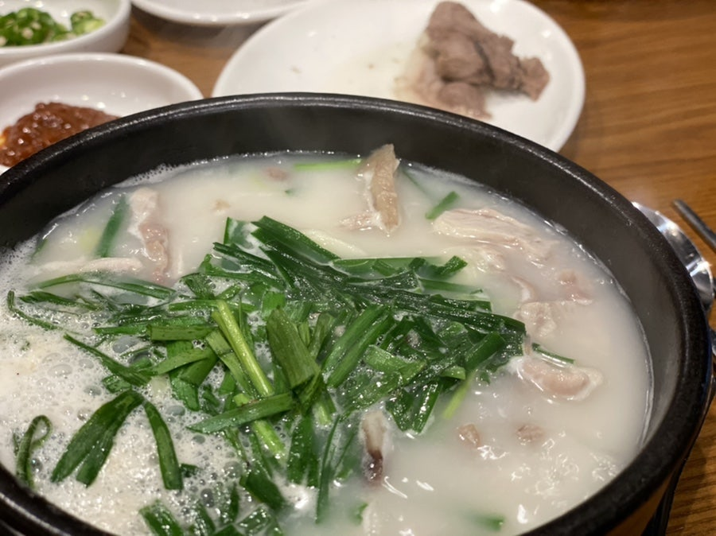

이왕 나온김에 연휴 기간 남아도는 시간에 집을 좀 손보기 위해서 이케아에 들렀다.
요즘 싱크대가 너무 마음에 안들고, 현관도 마음에 안들고, 수전도 마음에 안들어서 볼때마다 도라버릴 지경.
한창 집 인테리어를 시작할 때 쯤 개인적인 일로 옴짝달싹 못하고 집에 감금되어 있을 시기라,
하나하나 챙기지 못하고 턴키로 맡겨버린 부분이 결국 말썽이고 결국 마음에 안들기 시작했다.
싱크대도 수전도 사급한 자재는 마음에 드는데 그 외의 것은 다 갖다버리고 싶은 이 마음.
.
.
요즘은 요런 스테인리스 하부장에 원목 상판이 땡깁니다...
주방 규모도 우리집이랑 비슷한 너낌이라 참고할 겸 사진 한장 찰칵.

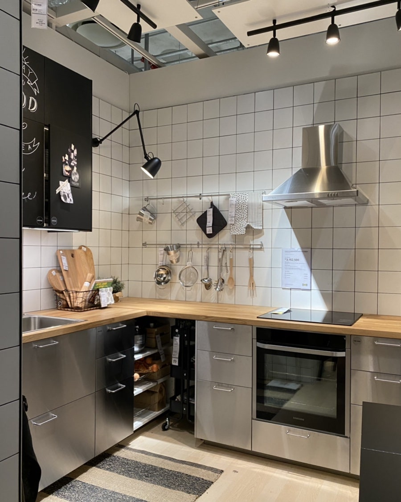

주방은 너무 비싸니까 못사고 요즘 온돌 마니아가 되어버린 반려인간을 위해 거실용 쟈근 매트를 사다주었다.
색깔도 시퍼런것이 인테리어 파괴엔 이것만한 것이 없다 싶지만 누워보니까 너무 좋고.. 편하고...
우리 고양이도 좋아하고요? 요즘엔 네식구 전부 여기 달라붙어 지내고 있는 웃픈 현실.

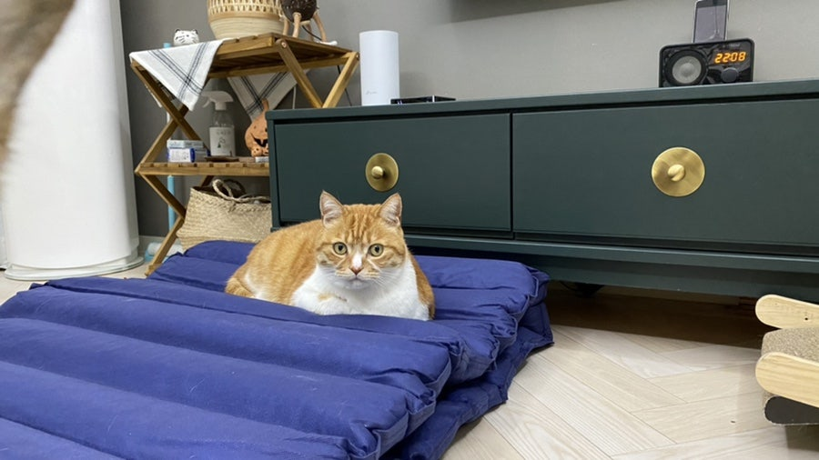

2020년 한해의 마무리는 우리 수준에 딱 맞는 영화 프린스 코기
그리고 맥주 한캔과 생선튀김으로.
조용하고 조촐하게 우리만의 방식으로(언제는 안그랬었던 것 처럼 새삼스럽다) 보낸 2020년 마무리.

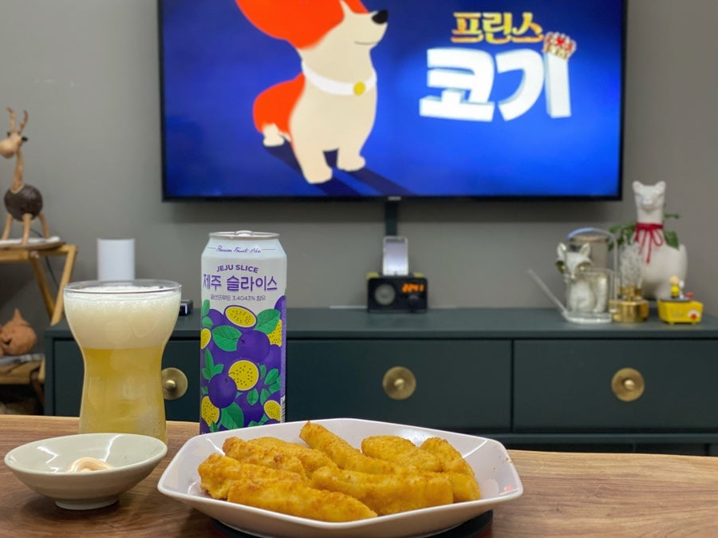

그림이어도 개인걸 아는지 몹시 흥분하신 우리 개님.
꼬리가 우뚝 섰다.
태생이 사람을 안좋아(싫어)하고 친구가 없는 집사내외와는 다르게 인싸인 우리 개님.
요즘 산책메이트 할머니와 엄마, 아빠를 빼고는 사람을 거의 못만나서 몹시 울적하실 것 같다.
얼른 이 대란이 지나가길 비나이다.

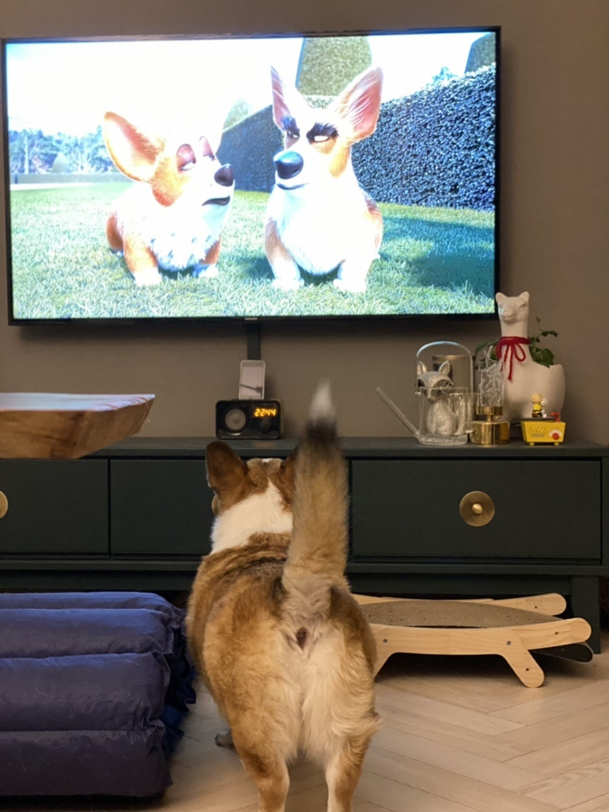

2021년 첫 식사는 언제나 처럼 감바스 알 아히요에 양조절 실패한 파스타 면사리 추가요.
나이를 제법 많이 먹고 나니 오늘이 내일같고 어제가 모레 같아서 새해란 느낌도 잘 안난다.
그저 회사 안가는 좋은 쉬는날일 뿐이고요?

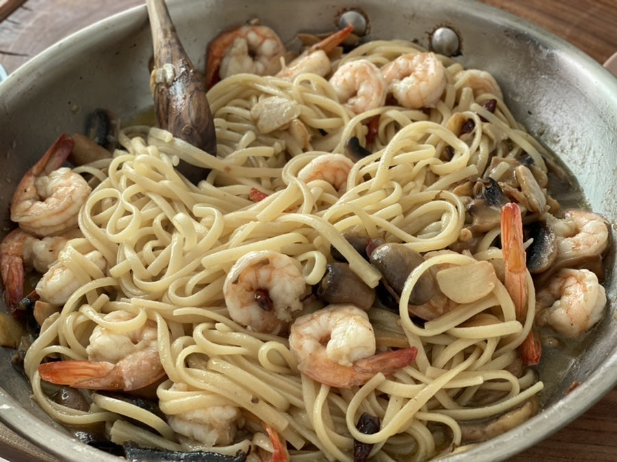

느지막하게 밥을 먹고는 김마루랑 산책을 나갔다.
맨날 할머니 혹은 할머니+엄마랑 산책다니다가 오랜만에 집사 내외 끼고 산책나오니 그 기세가 당당하다.

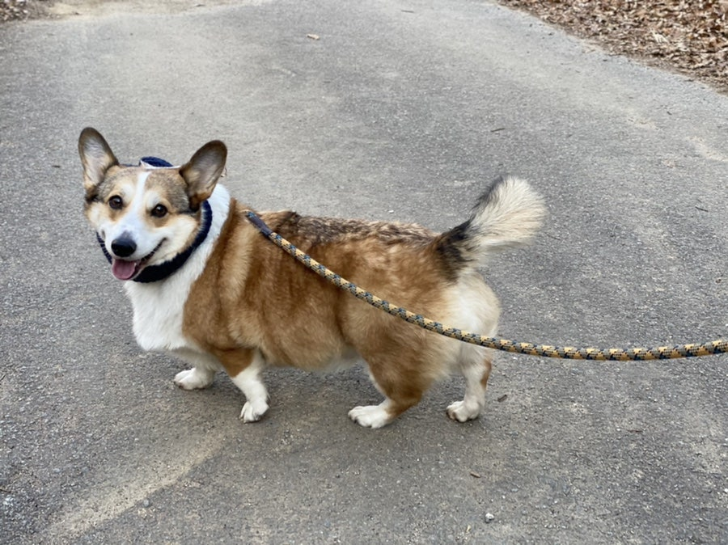

숙원 사업이었던 수전 교체 완료.
초록색 녹이 나기 시작한 수전을 볼때마다 마음이 심란했는데 마음에 쏙 드는 수전으로 교체 완료.
사실 그로헤 라던가.. 뭐 그런 비싸고 근사한 수전에 관심이 없었던 것은 아니지만
그 가격이 너무너무너무너무 놀라웠고요?
이케아 수전 네개 살 돈으로 그로헤 한개밖에 못사는 것 실화입니까...
그래서 결국 나는 또 이케아.
운 좋게도 욕실 도기와 하부장을 이케아 제품으로 맞춘 덕에 배수구멍까지 완벽하게 골드골드 깔맞춤 성공.
수도꼭지만 주는 줄 알았는데 금색 배수구까지 주다니 이거 완전 개이득 아니냐 이거애오.
.
태생이 기계 혹은 공구와 거리가 먼 우리 반려인간은 내가 필요할 때 불러서 물리적인 힘만 제공했고요?
나머지는 제가 다 했읍니다. 나새끼 치얼쓰.

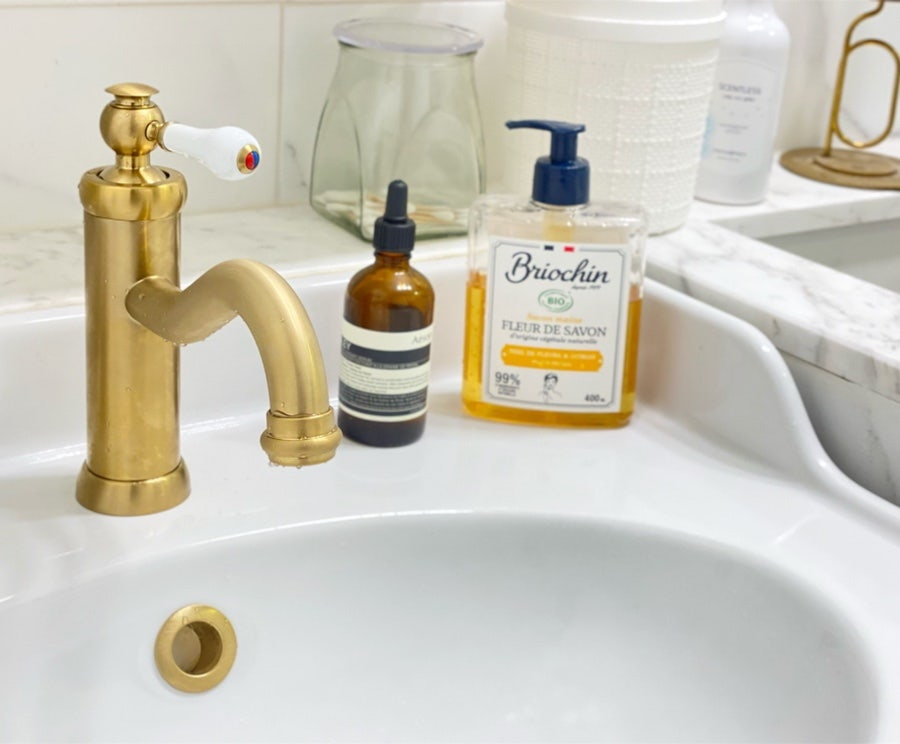

1,2,3 층 세개의 화장실과 주방 수전까지 교체한다고 힘을 뺐더니 엄동설한도 잊고 땀으로 샤워를 했다.
어쩐지 시원하고 상큼한 것이 먹고 싶어서 냉면을 시킬까 하다가 제주 둘레국수에 순대를 시켜서 저녁식사 냠냠.
아바이 순대를 먹고 싶었는데 품절이라니ㅠㅠㅠㅠㅠ

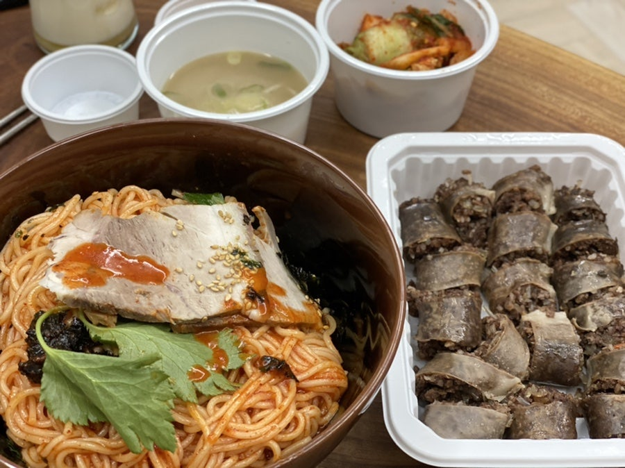

허버허버 돼지처럼 저녁을 해치우고는 미련이 남아서 밤 열두시가 다 된 시간에 쿠키를 굽기 시작했다.
예.. 그렇습니다.
저는 제법 쿠키에 진심인 편입니다.
크리스마스 때 처럼 12개를 구울 수 있는 반죽을 만들었는데 시간이 너무 늦었고요?
두판 굽자니 잠도 오고 귀찮아서 한판에 들어갈 양으로 접시만하게 다섯개를 빚었읍니다.
목표는 얼그레이 쿠키였는데 만들다보니 쫀득한 마시멜로우도 먹고 싶고 로투스 달달함도 땡기쟈나요.
그래서 그냥 있는대로 다 투척하고 박력 넘치는 쿠키를 구워봄.
맛 없을 수 없는 조합이다.

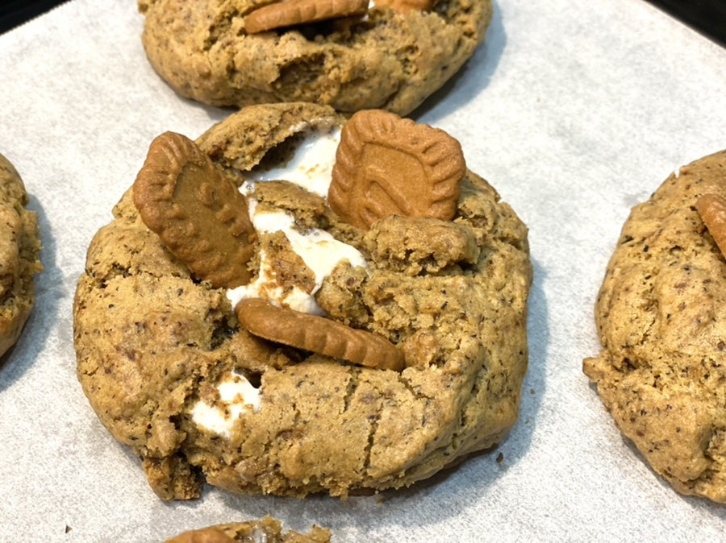

연휴 둘째날은 새해를 맞이하여 집안 구석구석 널부러진 크리스마스 장식들을 정리했다.
안녕. 올 겨울에 다시 만나.

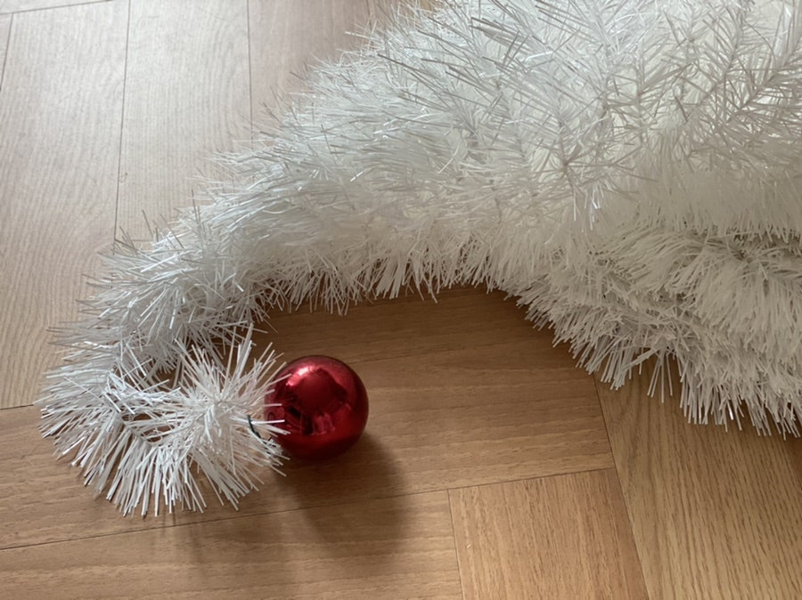

김마루를 데리고 다운타운에 산책을 다녀왔다.
오랜만에 이사람 저사람 많이 만나고 예쁘다 귀엽다 소리 잔뜩 들어서 개신난 우리개.

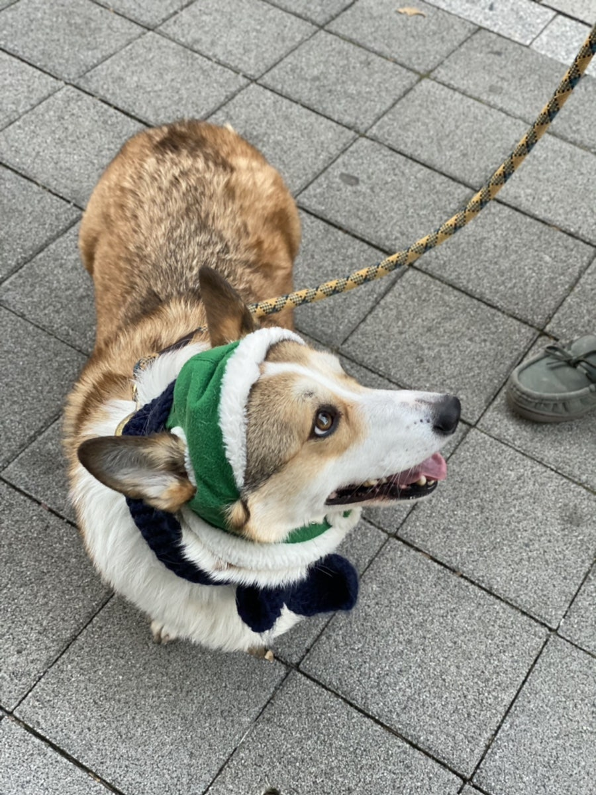

새해의 첫 월요일.
여느때와 다름없이 오전근무를 마치고 엄마를 데리러 다운타운에 다녀왔다.
올라 오는길에 달봄빵집에 들러 엄마가 제일 좋아하는 팥 카스테라와 호두식빵을 사다가 점심 한끼.
새해 첫 함께하는 식사니까 예쁘게 플레이팅 하자며 계절에도 안맞는 산타와 눈사람 컵을 가지고 온 엄마가 귀엽다.
요즘은 60먹은 엄마를 육아하는 느낌이라 이거애오.

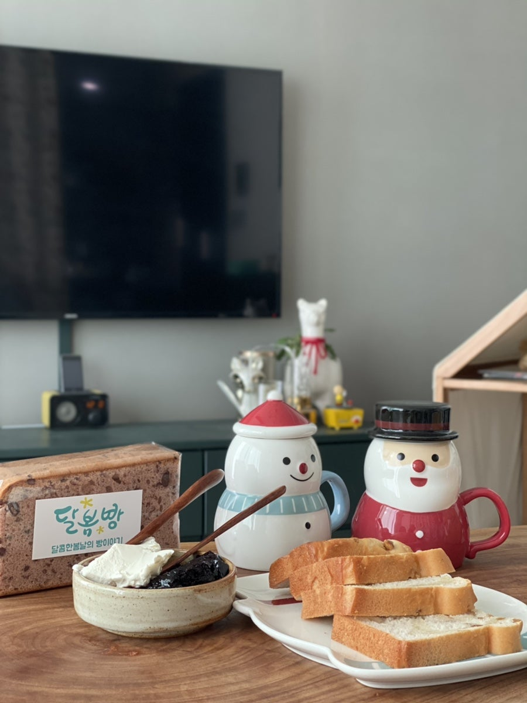

오후에 컨퍼런스 콜이 잔뜩이었는데 냥형이 자꾸 와서 깝죽거리길래 혼을 냈더니 여기 짱박혀 있내.
한동안 안보여서 어디 숨었나 찾아 헤메었는데 이제는 덩치에도 안맞는 요 귀요미 집에 숨어있을 줄이야.

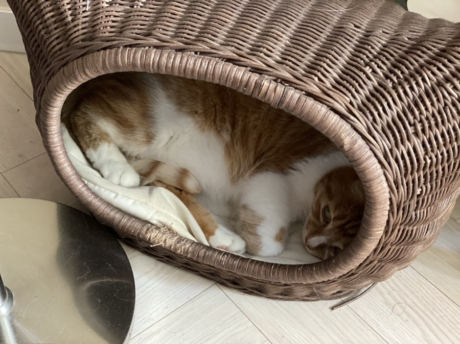

마음같아서는 싱크대를 전부 갈아엎고 싶어서 이케아 싱크 견적까지 받아왔는데 반려인간이 반려했다.
반려인간은 반려만해서 반려인간인가요?
멀쩡한 싱크대를 왜 바꾸냐고 하는데 내눈에는 이미 안멀쩡하다 이거애오.
아쉬운대로 접시 정리대를 잔뜩 사서 접시를 정리하고 수납공간을 만들었다.
이거 말고 싱크대 하부장도 싹 정리했는데, 정리를 했음에도 불구하고 귀신나올 것 같아서 사진은 패쓰.

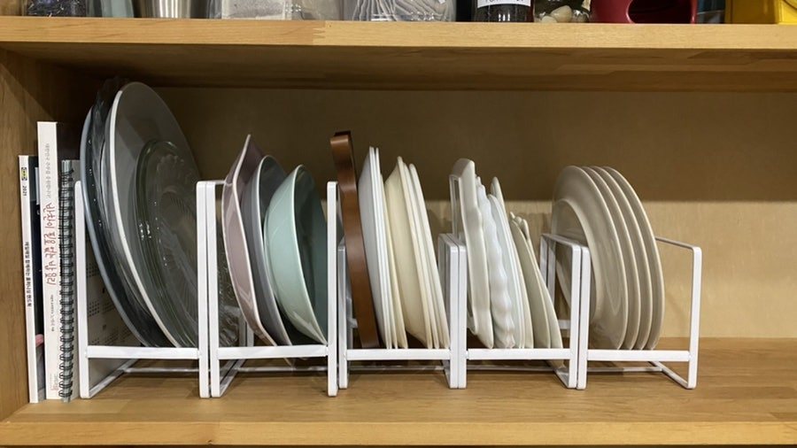

자고 일어나 눈을 떴는에 눈 앞에 펼쳐진 풍경이 너무 예뻐서 잠결에도 사진을 막 찍었나부다.
시계를 보면 7시 50분인데, 이시간에도 잠결일 수 있다니, 재택근무 만만세.
요즘 우리집에서 제일 예쁜 공간.
1층에 있던 흔들의자가 반려인간의 반려로 2층 침실로 올라왔는데 나름 잘 어울리고 예쁘다.

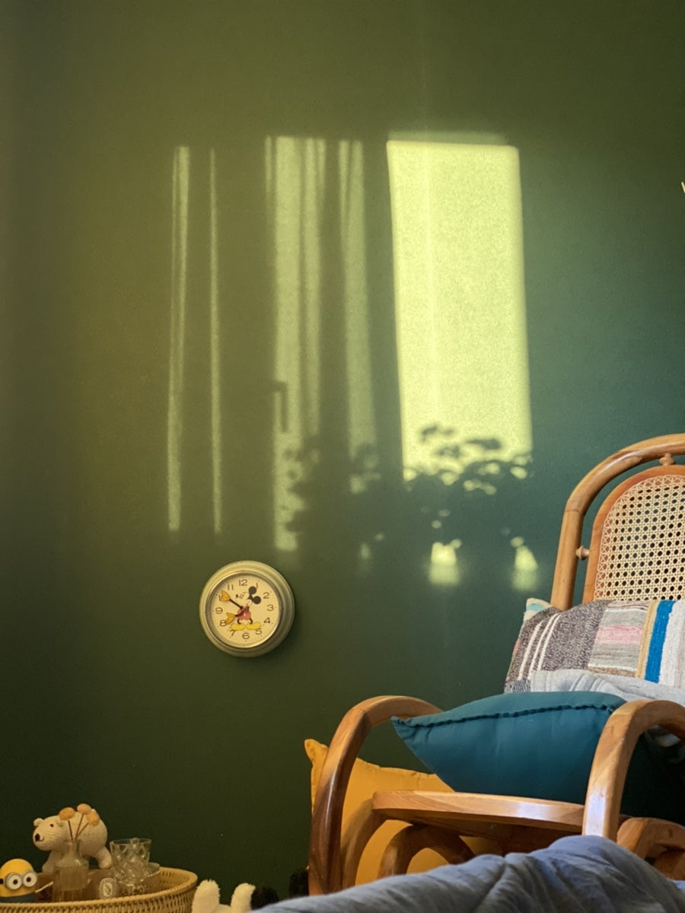

몇달 전 부터 이케아 갈 때마다 탐이 났었던 펭귄 모녀(?)
맨날 살까말까 고민하다 들어다 놨다만 백번하고 내려놓았던 아이템인데,
저번에 이케아 갔을 때 딱 하나 남은걸 보고 이건 사야해(!) 하며 홀린듯 집어 와버렸다.
나의 쟈근 서재에 너무나도 잘 어울리는 펭귄들.
훌륭한 소비였다.

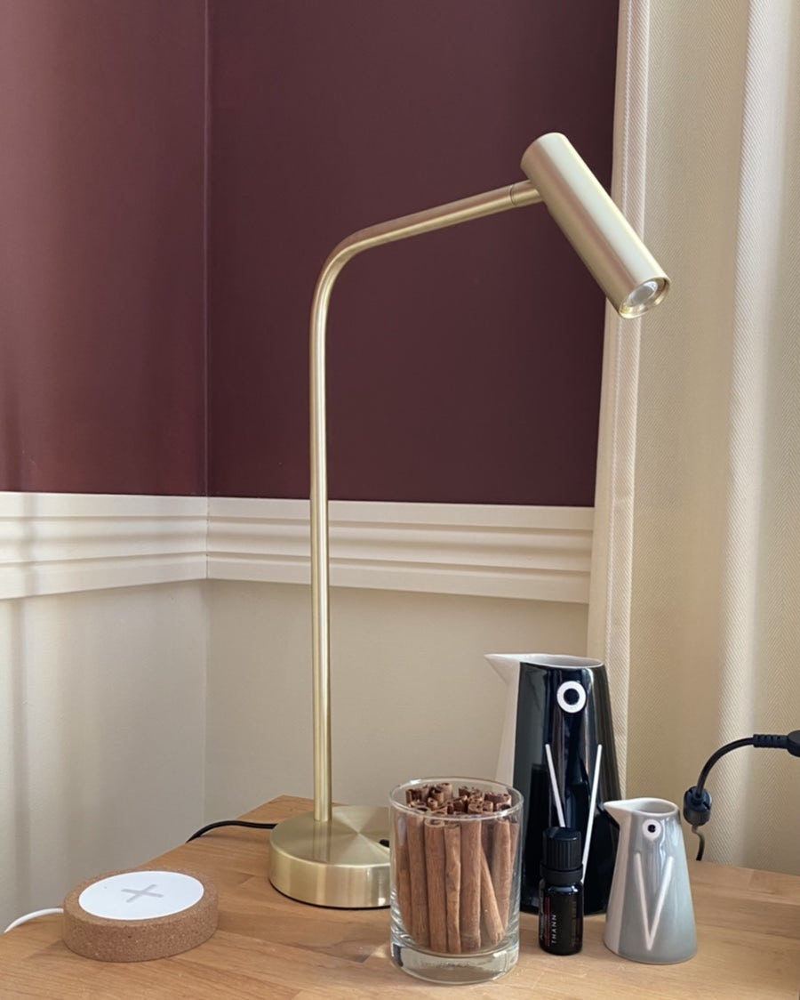

햇살 가득 요즘 너무 좋은 나의 홈 오피스.
짐이 자꾸자꾸 늘어 나는 것은 함정이지만, 어쩐지 나만의 공간이 있다는 것은 행복한일.
반려인간 미안하다.

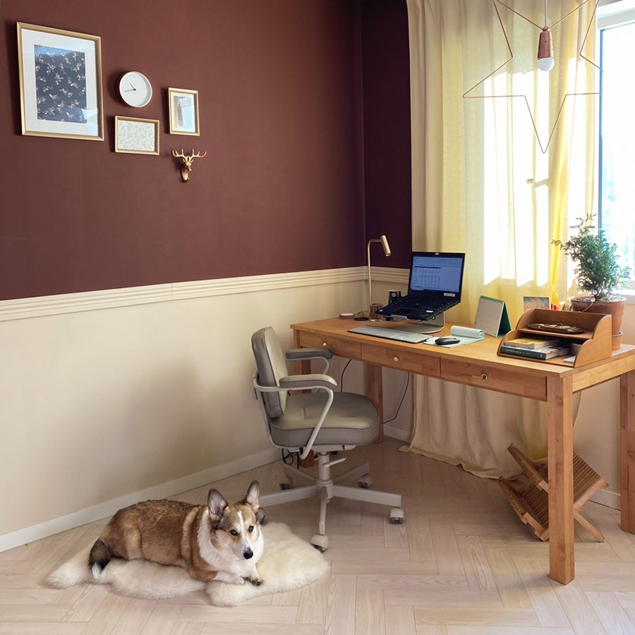

점심시간에 거실에 내려와보니 우리 고영은 햇살 넘치는 거실바닥에서 등짝을 지지고있다.
요렇게 팔자 늘어진 우리 고영보면 귀엽다가도, 이 엄동설한에 길에서 고생할 길친구들 생각하면 마음이 안좋다.
인간이야 뭐 알아서들 하겠지.

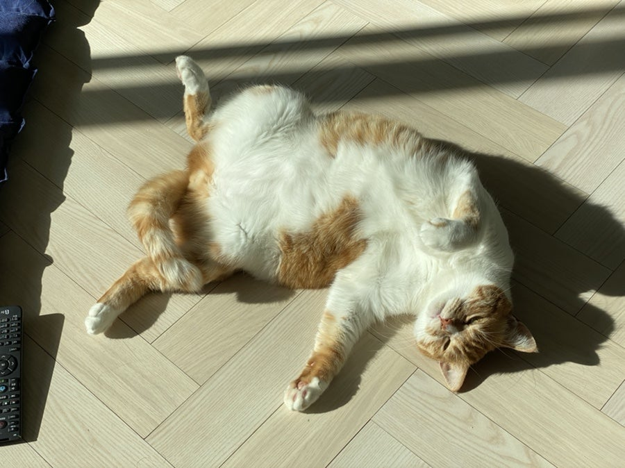

후하후하.
현관으로 말할 것 같으면 요즘 제일 맘에 안드는 집구석 1위.
시공할 때 따로 신경을 안썼더니 좁은 공간에 짙은 회색 문짝이랑,
내가 제일 싫어하는 싸구려 금속레일 손잡이를 달아놔서 볼 때 마다 속이 터짐.
거기다 사급한 조명은 나름 샹들리에랍시고 사다놨는데 불빛이 상향이라 집의 첫인상이 미녀와 야수의 야수네 성처럼 어두침침했고요?
야수네 집은 넓기라도 하지 저희 집은 손바닥만 하쟈나요 ㅠㅠㅠ
문짝을 시트지로 바를까, 아예 문짝만 교체할까 요리조리 돈 쓸 궁리를 하고 견적도 받아보다가,
일단은 제일 적은 돈으로 바꿀 수 있는 조명부터 교체 완료.
이케아에서 14800원에 데려온 가성비 넘치는 네블링에 조명으로 조도 확보 완료.
밝아지고 나니 훨씬 낫긴 하지만 회색 장이 너무 잘 보여서 속이 터진다.
오늘은 레일 손잡이도 다 뗴었으니 조만간 깨끗하게 정리를 하고 한번 더 사진을 찍어서 객관적으로 봐야지.

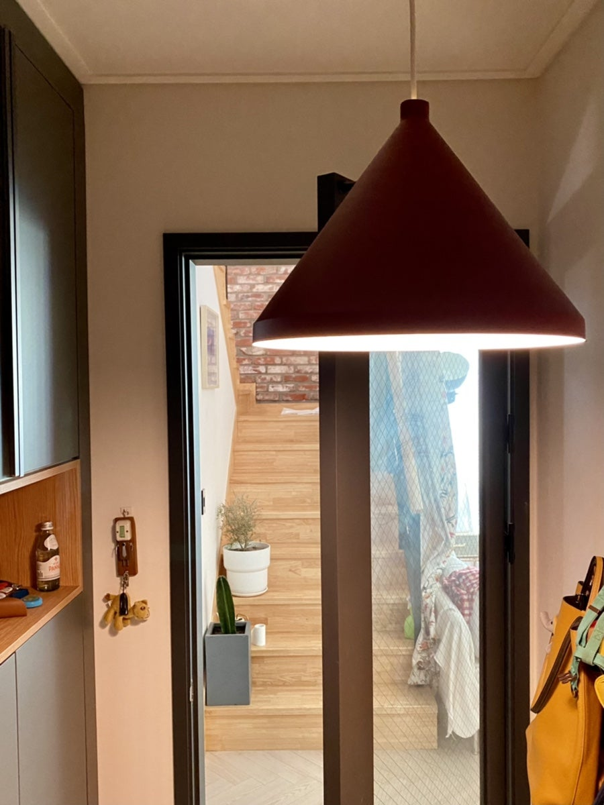

1월 7일.
눈이 내렸다가 아니라 눈폭탄이 떨어졌다가 맞을 것 같은 눈오는 날.
저녁 먹고 엄마를 데려다주고 올라 오는데 슬슬 흩날리기 시작한 눈발이 몇분 사이에 미친듯이 쏟아지기 시작했다.
우리 동네는 눈이 오면 애와 개만 신나고 어른들은 고통을 받곤한다.
그 중에 나는 어른 보다는 애나 개에 좀 가까운 편인데, 우리 개를 데리고 나가서 둘이 신나게 뛰어다녔다.
눈이야 뭐 반려인간이 알아서 치우겠지. 희희.

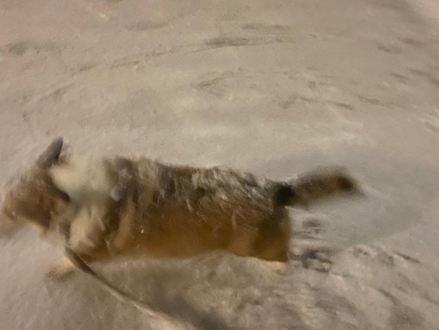

한껏 신난 우리 둘 ^^
양말도 안신고 나가서 발모가지 날아가는 줄 알았지만 우리 개가 저렇게 신나하니 되었다.
그나저나 반려인간 사진찍는 기술 왜 이모양이죠?

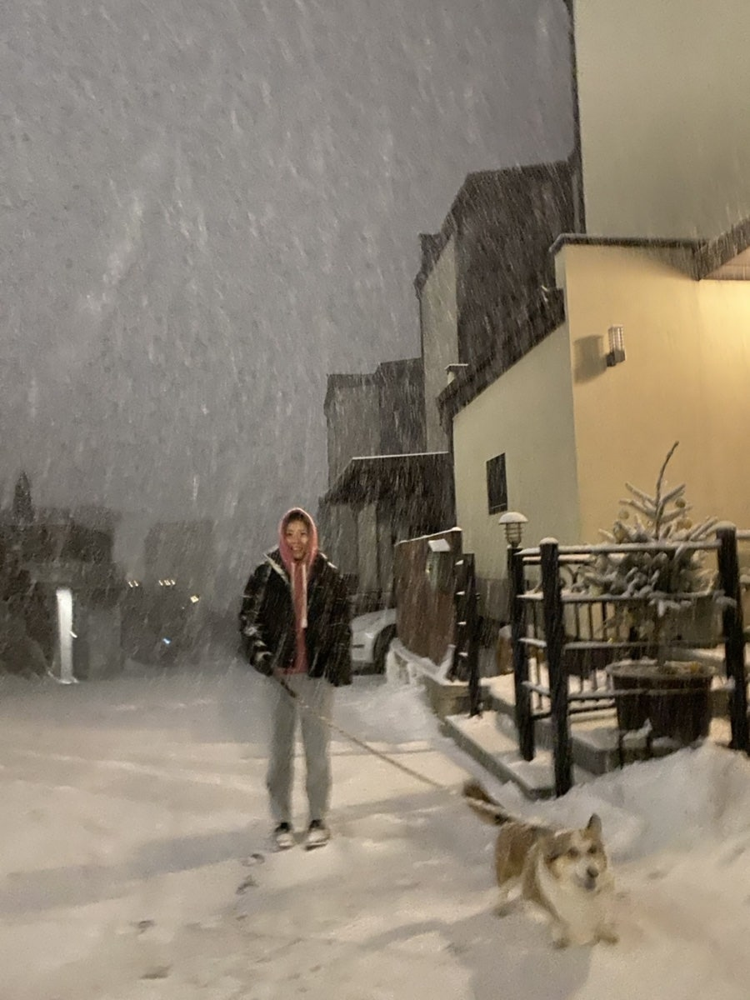

정신 없이 눈을 쓸고 집에 들어와서 밖을 보니 눈이 이만치나 쌓였다.
백설기 같고 맛있어 보이는건 배가 고파서일까?

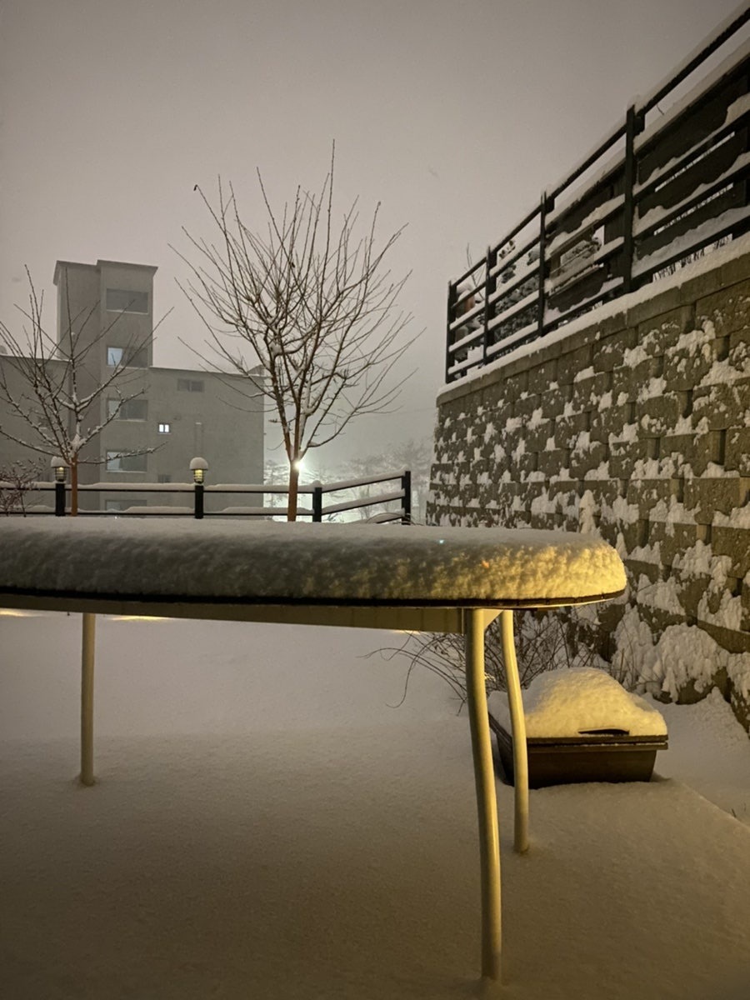

아침에 일어나니 온세상이 눈천지다.
두유워나빌더스노맨?

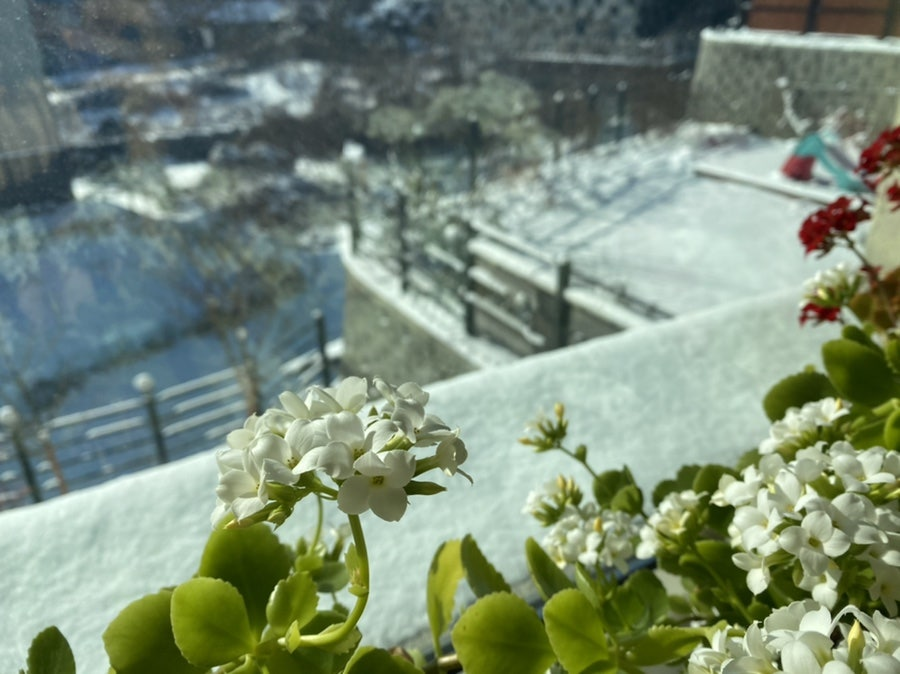

눈 좋아하는 강생이라 마당에 내어놓으니 우리개 다리가 사라졌다.
우리 마루 다리 어디갔져?
짧은 다리 때문에 김마루도 화가 난 너낌이다. ㅋㅋㅋㅋㅋㅋㅋㅋㅋㅋㅋㅋㅋㅋㅋㅋ

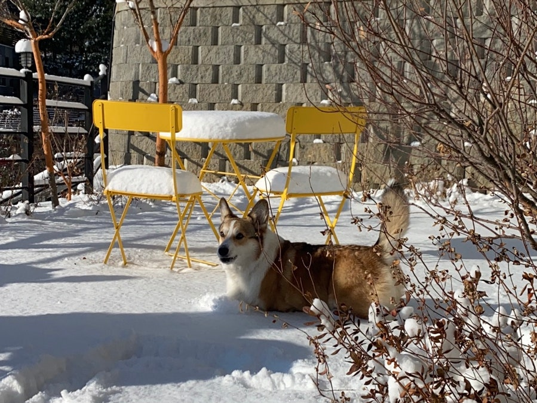

2층으로 내려가는 계단에서 본 우리동네 겨울왕국
여기 완죠니 아룬델 아니냐 이거애오.

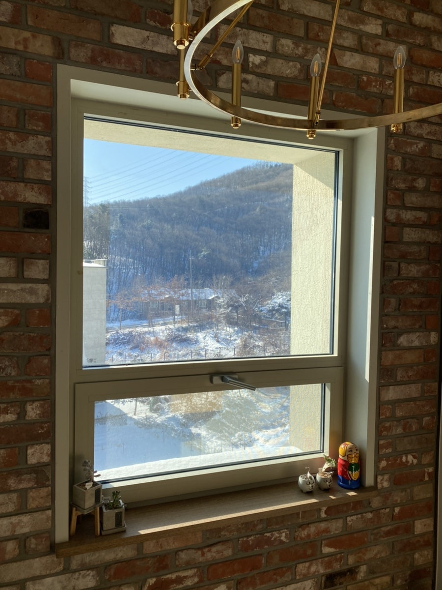

너무 춥고 미끄러워서 오늘 산책은 생존을 위해 패쓰하기로 했다.
대신 김마루만 마당에 실컷 풀어줬는데, 한참을 마당에서 뛰어놀더니 눈사람이 되어서는 문열어 달라고 짖는다.

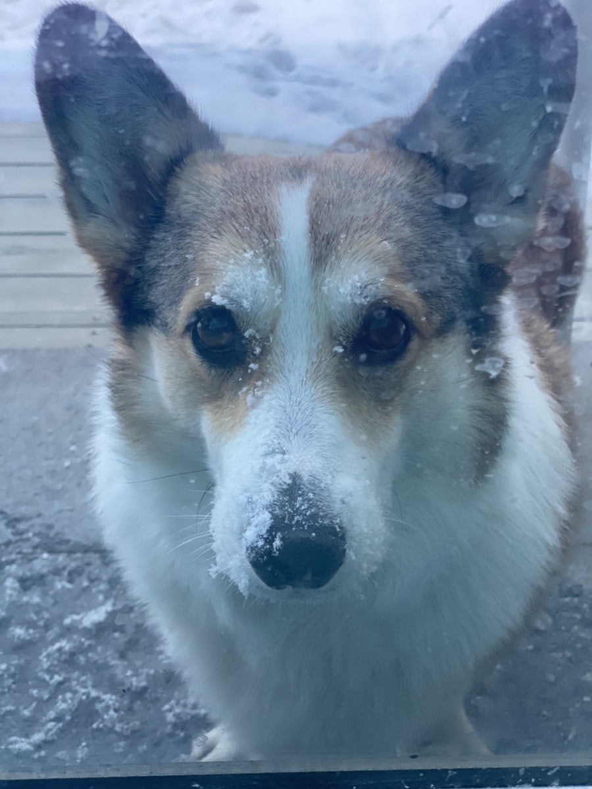

1월 16일은 우리 마루 네번째 생일.
평소에 눈여겨 봤던 멈머의 침대가 세일하길래 미리 생일 선물로 사줬는데,
어째 고양이 형한테 빼앗긴 느낌이다 ㅋㅋㅋㅋㅋㅋ
사진 찍은 시각 22시 49분, 방석이 16시쯤 배송 온 것 같은데 그때부터 꿈쩍도 안하고 방석 붙박이중.
김마루 생일 선물은 엄마가 다시 사줄게....ㅋㅋㅋㅋㅋㅋㅋㅋㅋㅋ

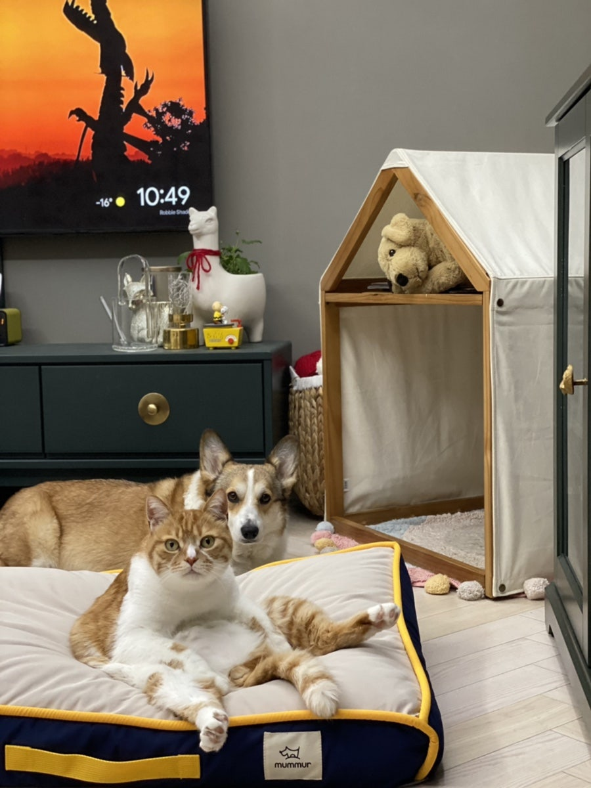

오늘은 직장용 자기 평가를 했다.
어쩐지 창작의 고통에 하루종일 시달린 느낌인데, 블로그 일기까지 쓰려니 일주일치 창작혼을 다 불태운 느낌이다.
이번주 일기 요기서 끗!
